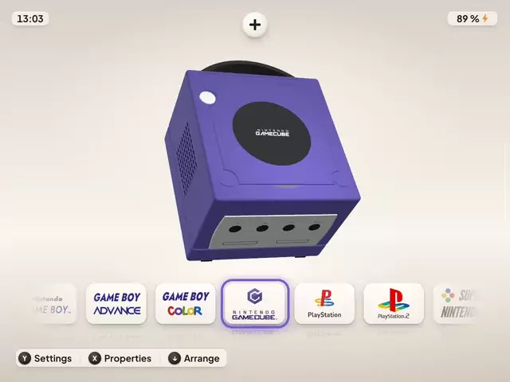
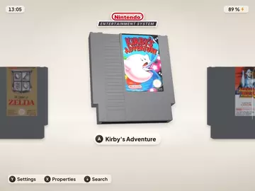
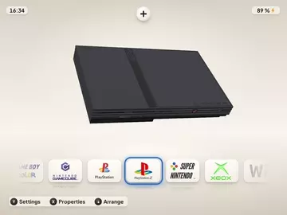
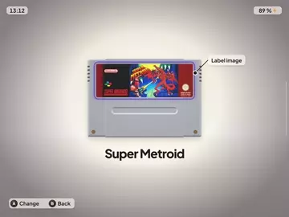
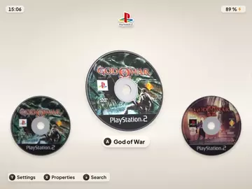
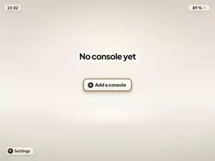

# Cartouche

A game launcher for Android handhelds that shows your games as physical discs and cartridges.
Cartouche does not emulate anything itself: it finds your games, recognises them, and starts them
in the emulators you already have. It is free and open source, and meant to stay easy to get into:
use it, contribute to it, or fork it and make it yours.

<p align="center"></p>

## What it does

<table>
<tr>
<td width="50%"><br><b>Immersion first:</b> a launch made for each console.</td>
<td width="50%"><br><b>Each model of it:</b> a PlayStation 2 slim or fat, a Game Boy Advance original or SP.</td>
</tr>
<tr>
<td><br><b>Smart labels:</b> each game recognised from its own file, its real label from ScreenScraper and LaunchBox, your region first; another region or your own picture one menu away.</td>
<td><br><b>Your library:</b> filter by name or by region, rename a game or a console.</td>
</tr>
<tr>
<td><br><b>Your order:</b> put your consoles where you like on a wheel.</td>
<td><br><b>Controller first:</b> everything with the pad, from the first launch to adding a console; touch works too.</td>
</tr>
</table>

- **Uses your emulators.** It finds the emulators you installed and starts each game in the right one.
- **Speaks your language.** English, Français, Deutsch, Español, Italiano, Português (Portugal), Português (Brasil)
  and 日本語. It follows your device's language, English otherwise; **Language** in the settings picks another.
- **Light on your device.** On a Snapdragon 8 Gen 2 handheld the games screen holds about 200 MB of graphics
  memory, a third of what version 0.4.1 took, and the download is 85 MB instead of 110 MB. Left alone, the app stops
  drawing everything but the background's moving veil, which the settings switch off. The games row costs the
  same with thousands of games as with a few.

## Consoles

Nineteen consoles, each a 3D model of the real one. Twelve are ready to play; the PSP, PS Vita, DS Lite, Switch, Master
System, Mega Drive and Dreamcast are shown greyed as coming soon until their launch is made.

| Maker | Consoles |
|---|---|
| Nintendo | NES · Super Nintendo · Nintendo 64 · GameCube · Wii · Switch (neon or grey) · Game Boy · Game Boy Color · Game Boy Advance (original or SP) · DS Lite |
| Sony | PlayStation · PlayStation 2 (slim or fat) · PSP · PS Vita |
| Sega | Master System · Mega Drive (model 1 or 2) · Dreamcast |
| Microsoft | Xbox · Xbox 360 |

## Install

Download the APK from this repository's Releases page and install it on your handheld. You need Android 11 or
later on an arm64 device with Vulkan, and the emulators of the consoles you want to play.

## How a label is found

1. **Which game.** Cartouche reads the file itself (a cartridge's CRC32, a disc's serial) and looks it up in the
   No-Intro and Redump lists; when the file says nothing, its name decides.
2. **Which images.** LaunchBox's scans, found by the game's name; ScreenScraper's images, found in a table shipped
   with the app (`app/data/screenscraper/`), so the device never asks ScreenScraper which game a file is and only
   downloads images; for PS2 discs, psxdatacenter's scans, by serial.
3. **Which one first.** An image of the game's region (its country, or the zone containing it: France → Europe):
   on a cartridge ScreenScraper's, then LaunchBox's; on a disc LaunchBox's, then ScreenScraper's, then
   psxdatacenter's. Then every other image, closest region first. The first that downloads is kept.
4. **Yours stays.** A label you chose, or a picture of your own, is never replaced. A game's properties list every
   image of every source. When ScreenScraper cannot answer, the next image is taken and ScreenScraper is tried again
   at a later scan.

## Contributing

Ideas, feedback and pull requests are welcome; open an issue to talk about a bigger change first. Help is most
wanted on:

- **3D models** of the consoles and their discs and cartridges: closer to the real thing, lighter to draw.
- **A music theme** for the menus.
- **New consoles** ([docs/adding-a-console.md](docs/adding-a-console.md)).
- **Translations:** a native reader for Japanese and Portuguese, or a new language
  ([docs/translating.md](docs/translating.md)).
- **Integrations** such as RetroAchievements or RomM.

[CONTRIBUTING.md](CONTRIBUTING.md) says how to build, check and send a change; [docs/README.md](docs/README.md)
maps the code and has one short guide per kind of addition.

## Building

```sh
export JAVA_HOME=/path/to/jdk-17 ANDROID_HOME=/path/to/android-sdk GODOT=/path/to/godot
scripts/build.sh                # every check and test, then the debug APK in build/
scripts/build.sh --install      # the same, then installs and starts it on the connected device
```

You need Godot 4.7.2 with its export templates, JDK 17, the Android SDK, Python 3 and gdtoolkit 4; the exact
versions are in [CONTRIBUTING.md](CONTRIBUTING.md#build-and-check). Releases are exported with
Cartouche's own Godot Android template: Godot 4.7.2 plus six small patches, built once with
`scripts/godot_template.sh build` and cached. Without it the export uses Godot's official template: the same app,
heavier ([docs/README.md](docs/README.md#the-engine-template)).

## Stack

- **Android only**, from Android 11 (API 30) to Android 16 (API 36), arm64 with Vulkan. On a desktop the Godot
  project runs on a demo library, to work on the screens without a device.
- **App:** [Godot](https://godotengine.org) 4.7.2 (GDScript, Mobile renderer).
- **Domain and Android plugin:** Kotlin 2.1.21 with [Arrow](https://arrow-kt.io) 2.1.2, kotlinx.serialization 1.8.1
  and kotlinx.coroutines 1.10.2; Gradle 8.11.1, Android Gradle Plugin 8.6.1, JDK 17.
- **Tests:** [Kotest](https://kotest.io) 5.9.1, [Robolectric](https://robolectric.org) 4.16.1,
  [GdUnit4](https://github.com/MikeSchulze/gdUnit4) 6.2.1, ktlint.

## Credits

Cartouche builds on these projects, and thanks their authors.

| Project | Used for | License |
|---|---|---|
| [Daijishō](https://github.com/TapiocaFox/Daijishou) | Platform and emulator definitions (`app/data/platforms/daijishou/`) | MIT |
| [libretro-database](https://github.com/libretro/libretro-database) | Redump and No-Intro game titles and serials (`app/data/titles/`), cartridge ROMs' CRC32 (`app/data/prints/`) | CC BY-SA 4.0 |
| [LaunchBox Games Database](https://gamesdb.launchbox-app.com) | Which disc and cartridge scans each game has (`app/data/art/`), and the scans, downloaded on the device | Used with the database's public dump; images stay their owners' |
| [ScreenScraper](https://www.screenscraper.fr) | Which disc and cartridge images each release has (`app/data/screenscraper/`), and the images, downloaded on the device | Data under CC BY-NC-SA 4.0; images stay their owners' |
| [PlayStation DataCenter](https://psxdatacenter.com) | PS2 disc scans by serial, downloaded on the device | Images stay their owners' |
| [Fredoka](https://github.com/hafontia/Fredoka-One) | The font of the games' labels (`app/fonts/`) | SIL Open Font License 1.1 |
| [Plus Jakarta Sans](https://github.com/tokotype/PlusJakartaSans) | The app's text (`app/fonts/plus-jakarta-sans/`) | SIL Open Font License 1.1 |
| [IBM Plex Mono](https://github.com/IBM/plex) | The app's monospaced notes, counts and kickers (`app/fonts/ibm-plex-mono/`), Reserved Font Name "Plex" | SIL Open Font License 1.1 |
| [Godot Engine](https://godotengine.org) | Engine, and the Android plugin template the plugin started from | MIT |
| [Arrow](https://arrow-kt.io) | Typed functional programming in Kotlin | Apache 2.0 |
| [XZ for Java](https://tukaani.org/xz/java.html) | LZMA decoding of CHD disc images | 0BSD |
| [kotlinx.serialization, kotlinx.coroutines](https://github.com/Kotlin) | JSON storage, background work, and its tests | Apache 2.0 |
| [Kotest](https://kotest.io) | Property-based tests | Apache 2.0 |
| [JUnit 4](https://junit.org/junit4/) | Test runner | EPL 1.0 |
| [Robolectric](https://robolectric.org) | Android tests on the JVM | MIT |
| [GdUnit4](https://github.com/MikeSchulze/gdUnit4) | GDScript tests (downloaded by `scripts/test_godot.sh`, not shipped) | MIT |
| [ktlint](https://pinterest.github.io/ktlint/) | Kotlin style | MIT |
| [Gradle](https://gradle.org) | Build, and the wrapper in `kotlin/` | Apache 2.0 |

### 3D models

The consoles' 3D models are adapted from these downloads (CC-BY-4.0, licence texts beside each model in `app/carousel/consoles/`):

- This work is based on "NES Console and Controller" (https://sketchfab.com/3d-models/nes-console-and-controller-ffd427134d5e44b4850628030aa66236) by Daz (https://sketchfab.com/Darren.Hogan) licensed under CC-BY-4.0 (http://creativecommons.org/licenses/by/4.0/)
- This work is based on "Game Boy Color" (https://sketchfab.com/3d-models/game-boy-color-03c6fe28d45244d2acd55486e3cfee19) by Wikiti (https://sketchfab.com/wikiti) licensed under CC-BY-4.0 (http://creativecommons.org/licenses/by/4.0/)
- This work is based on "Super Retro Game Console" (https://sketchfab.com/3d-models/super-retro-game-console-d672d0ac1d6a4d238314d6675f8f92b2) by ELIZION (https://sketchfab.com/ELIZION) licensed under CC-BY-4.0 (http://creativecommons.org/licenses/by/4.0/)
- This work is based on "Sony PlayStation 2" (https://sketchfab.com/3d-models/sony-playstation-2-b53f858aa1584229a7f906239fc158a2) by Dolgov (https://sketchfab.com/Dolgov12) licensed under CC-BY-4.0 (http://creativecommons.org/licenses/by/4.0/)
- This work is based on "Gameboy Advance SP" (https://sketchfab.com/3d-models/gameboy-advance-sp-18c9688eaa8f4903a940c105242df15f) by thegraphicsgeek (https://sketchfab.com/thegraphicsgeek) licensed under CC-BY-4.0 (http://creativecommons.org/licenses/by/4.0/)
- This work is based on "Sony PSP" (https://sketchfab.com/3d-models/sony-psp-dca89d10ec304d0cab76837750df7761) by Ilya Ostrovsky (https://sketchfab.com/strov) licensed under CC-BY-4.0 (http://creativecommons.org/licenses/by/4.0/)
- This work is based on "Nintendo Switch" (https://sketchfab.com/3d-models/nintendo-switch-c73fadccfdc547f9958fd8a1cdbe4811) by HarrisonHag1 (https://sketchfab.com/HarrisonHag1) licensed under CC-BY-4.0 (http://creativecommons.org/licenses/by/4.0/)
- This work is based on "Sega Dreamcast" (https://sketchfab.com/3d-models/sega-dreamcast-f82d99e4739e42f4abfc37cb97918cfc) by Zerescas (https://sketchfab.com/zerescas) licensed under CC-BY-4.0 (http://creativecommons.org/licenses/by/4.0/)
- This work is based on "Sega_Genesis" (https://sketchfab.com/3d-models/sega-genesis-d1487aa8b216490ba7c414b95531479e) by kaveshkoli3 (https://sketchfab.com/kaveshkoli3) licensed under CC-BY-4.0 (http://creativecommons.org/licenses/by/4.0/)
- This work is based on "Sega Master System" (https://sketchfab.com/3d-models/sega-master-system-0ec998c9b9de4e7f956cab56bbca3c0f) by dark_igorek (https://sketchfab.com/dark_igorek) licensed under CC-BY-4.0 (http://creativecommons.org/licenses/by/4.0/)
- This work is based on "Sega Genesis Model 2 / Sega Mega Drive" (https://sketchfab.com/3d-models/sega-genesis-model-2-sega-mega-drive-d8feaa413cc847a599e6a484cc4ed2b6) by Zerescas (https://sketchfab.com/zerescas) licensed under CC-BY-4.0 (http://creativecommons.org/licenses/by/4.0/)
- This work is based on "PS Vita" (https://sketchfab.com/3d-models/ps-vita-d0241d08cee04a169148c275cecc1a5b) by mxiv (https://sketchfab.com/mxiv) licensed under CC-BY-4.0 (http://creativecommons.org/licenses/by/4.0/)
- This work is based on "Nintendo DS Lite" (https://sketchfab.com/3d-models/nintendo-ds-lite-ca529eb7208746e89b7a28fd2246659d) by Cianon (https://sketchfab.com/Cianon) licensed under CC-BY-4.0 (http://creativecommons.org/licenses/by/4.0/)

### Console logos

The consoles' logos (`app/studio/logos/`) are the official ones, taken from Wikimedia Commons, where they are in the
public domain as too simple for copyright; they remain trademarks of their owners (Sony, Microsoft, Nintendo, Sega):
[PlayStation](https://commons.wikimedia.org/wiki/File:Playstation_logo_colour.svg),
[PlayStation 2](https://commons.wikimedia.org/wiki/File:PlayStation_2_logo.svg),
[PSP](https://commons.wikimedia.org/wiki/File:PSP_Logo.svg),
[PS Vita](https://commons.wikimedia.org/wiki/File:PlayStation_Vita_logo.svg),
[Xbox](https://commons.wikimedia.org/wiki/File:Xbox_2001_Stacked_Logo.svg),
[Xbox 360](https://commons.wikimedia.org/wiki/File:Xbox_360_wordmark.svg),
[NES](https://commons.wikimedia.org/wiki/File:NES_logo.svg),
[Super Nintendo](https://commons.wikimedia.org/wiki/File:Super_Nintendo_Entertainment_System_logo.svg),
[Nintendo 64](https://commons.wikimedia.org/wiki/File:Nintendo_64_wordmark.svg),
[GameCube](https://commons.wikimedia.org/wiki/File:Nintendo_GameCube_Official_Logo.svg),
[Wii](https://commons.wikimedia.org/wiki/File:Wii_logo_if_you_want_to_use_in_picture_quizzes.svg),
[Switch](https://commons.wikimedia.org/wiki/File:Nintendo_Switch_logo.svg),
[Game Boy](https://commons.wikimedia.org/wiki/File:Gameboy_logo.svg),
[Game Boy Color](https://commons.wikimedia.org/wiki/File:Game_Boy_Color_logo.svg),
[Game Boy Advance](https://commons.wikimedia.org/wiki/File:Game_Boy_Advance_logo.svg),
[DS Lite](https://commons.wikimedia.org/wiki/File:Nintendo_DS_Lite_logo.svg),
[Master System](https://commons.wikimedia.org/wiki/File:Master_System_Logo.svg),
[Mega Drive](https://commons.wikimedia.org/wiki/File:Sega_genesis_logo.svg),
[Dreamcast](https://commons.wikimedia.org/wiki/File:Dreamcast_logo_PAL.svg).

## License

Cartouche is free software under the [GNU GPL v3 or later](LICENSE).
