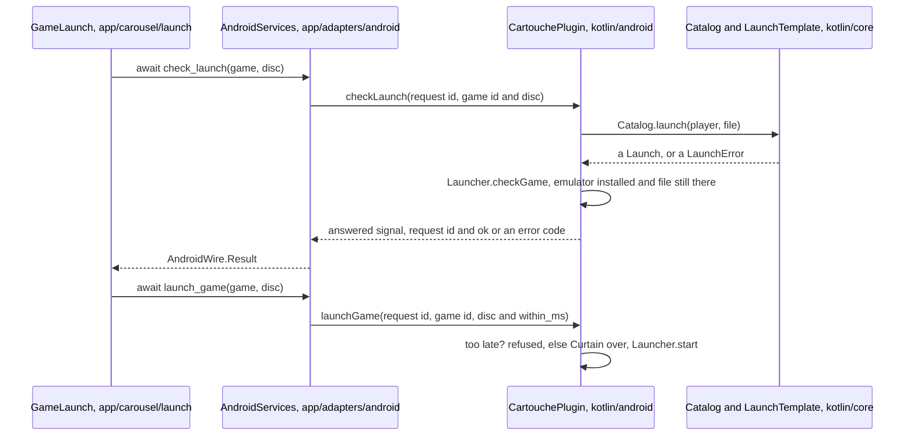

# Onboarding

Start here. This page tells you what Cartouche is, how its code is cut, how to build, run and test it, and which
page and files to open for the task in front of you. Every other page of `docs/` is one click from here, and each
one links back to its neighbours, so you can walk the map from any point.

## What Cartouche is

Cartouche is a game launcher for Android. It shows each console as a 3D model and each game as the disc or
cartridge it came on. It finds the games in the folders the user picks, identifies them from what their files
hold, downloads their real label scans in the background, and starts them in the emulators already installed.
It emulates nothing itself.

## The map

```text
README.md                      you are here: the entry, the commands, the "I want to…" index
├── GLOSSARY.md                every domain word, as the code spells it
├── INVARIANTS.md              the guarantees no change may break, and their tests
├── architecture/core.md       kotlin/core: the domain rules, pure Kotlin
├── architecture/android.md    kotlin/android: the Godot Android plugin around the core
├── architecture/godot.md      app/: screens, carousel, consoles, launches, the adapter
├── architecture/studio.md     app/studio: the look every screen shares
├── adding-a-console.md        a console's folder, its model, its launch, its tests
├── adding-a-medium.md         a disc or cartridge's folder, its model, its tests
├── testing.md                 the kinds of tests, their helpers, how to run each
├── sounds.md                  the gesture-to-sound table and how a sound plays
└── debug-bridge.md            the remote control of a running debug build
```

## Three layers

The code is cut in three layers. Each one depends only on the one below it.

| Layer | Folder | Holds | Never holds |
|---|---|---|---|
| Godot shell | `app/` | scenes, input, display, animation, sound | a domain rule (what a game is, which file to launch) |
| Android plugin | `kotlin/android/` | Android APIs, files, threads, network, the only mutable state | a rule the core can state as a pure function |
| Core | `kotlin/core/` | the domain as pure functions over immutable values | Android, IO, `null` |

GDScript reaches the plugin through one file, the `AndroidServices` autoload
(`app/adapters/android/android_services.gd`). It calls the plugin's `@UsedByGodot` methods, and turns each answer
into the typed values of `AndroidWire` (`app/adapters/android/android_wire.gd`). The plugin's side of that
format is `Wire.kt`. Only values Godot's JNI bridge converts cross it (INV-23).

On a desktop or in the editor there is no plugin. `AndroidServices` then calls `DesktopPlugin`
(`app/adapters/desktop/desktop_plugin.gd`), which has the plugin's method names and answers from the demo library
in `app/dev/demo/desktop.json`. The screens cannot tell the difference.

### How a press travels

Pressing A on a game asks the plugin whether it can start, then starts it. The same round trip carries every
operation: the screen awaits a coroutine of `AndroidServices`, the plugin works off Godot's thread and answers
through its `answered` signal, and the adapter hands back a typed value.



Getters (`battery`, `browse`, `title_marks`) answer at once instead. Signals that are not answers
(`art_changed`, `art_progress`, `label_variant_downloaded`, `battery_changed`) become the `AndroidServices` signals
of the same names.

## Repository layout

| Path | What it holds |
|---|---|
| `app/` | the Godot project: `project.godot`, scenes, scripts, shaders, shipped data |
| `app/data/` | data the app reads at start: platform definitions, title lists, art extracts, poses, lights |
| `app/test/` | GDScript tests (GdUnit4) |
| `kotlin/core/` | the pure domain, its tests and the shared test fixtures (`kotlin/core/src/testFixtures/`) |
| `kotlin/android/` | the Godot Android plugin and its Robolectric tests |
| `scripts/` | build, test, bench and data scripts |
| `docs/` | this map |

## Build, run and test

You need Godot 4.7.2 with its export templates, JDK 17, the Android SDK (platform 36, build tools 36.1.0,
NDK 29.0.14206865 and CMake 3.22.1, which Gradle installs when missing),
gdtoolkit 4 for `gdlint` (`pip install --user "gdtoolkit==4.*"`), Python 3, and `adb` to install on a device.

```sh
export JAVA_HOME=/path/to/jdk-17 ANDROID_HOME=/path/to/android-sdk
export GODOT=/path/to/godot          # if godot is not on PATH
scripts/build.sh                     # everything below, then the debug APK in build/
scripts/build.sh --install           # the same, then installs and starts it on the device adb sees
```

`scripts/build.sh` runs, in order: `scripts/check_docs.py`, `gdlint` on every app script, the Kotlin lint, tests,
Android lint and build, every GDScript test, `scripts/check_release.sh`, a short headless run of the project that
fails on any script error, then the APK export.

Run one part while you work:

```sh
cd kotlin && ./gradlew :core:test --tests '*ScanTest'              # one core test class
cd kotlin && ./gradlew :android:testDebugUnitTest --tests '*LauncherTest'
GODOT=$GODOT scripts/test_godot.sh res://test/carousel/search       # one GDScript folder or file
GODOT=$GODOT scripts/test_godot.sh                                  # every GDScript test
python3 scripts/check_docs.py                                       # every path and name the docs cite
```

To run the app on your computer, open `app/` in the Godot editor and press Play, or run
`$GODOT --path app`. The carousel shows the desktop demo library. Launching a game fails at the end, since no
emulator exists there, but every screen and animation plays.

On a device, `scripts/logs.sh` follows a debug build's traces, and `scripts/bench.sh` measures the installed build at
several library sizes.

### Diagnostics and debug arguments

In debug builds, `Diagnostics` (`app/dev/diagnostics.gd`) traces every input event, focus change, lifecycle
notification, plugin call and slow frame. The plugin traces intents, scans and timings the same way (`trace` in
`Wire.kt`). Add trace points with every feature. Holding Select for two seconds opens the device check
(`app/dev/device_check/`), one tab per device capability.

Debug builds read arguments after `--` on a desktop (`$GODOT --path app -- --shelf=gba`), and from the
`arguments` extra on a device
(`adb shell am start -n app.cartouche/com.godot.game.GodotAppLauncher --esa arguments --shelf=gba`).

| Argument | Effect | Read by |
|---|---|---|
| `--welcome=skip` | starts without waiting on the title screen | `Carousel` |
| `--shelf=gba` | opens on that platform's shelf | `Carousel` |
| `--demo-games=N` | a made-up library of N games, kept apart from the user's | `Carousel`, `DemoLibrary.kt` |
| `--demo-shelf=ps2` | puts every demo game on one console | `Carousel` |
| `--turntable=T` | turns the selected game at T turns a second | `Carousel` |
| `--bench=scroll` | runs one measured scenario (`scroll`, `enter`, `turn`, `launch`, others) | `CarouselBench` |
| `--msaa=N` | the 3D's antialiasing for a bench run | `CarouselBench` |
| `--shots=DIR` | saves pictures at set frames (run with `--fixed-fps 60`) | `FrameShots` |
| `--launch=rehearse` | every launch check passes and no emulator starts: the insertion plays, then the carousel returns | `AndroidServices` |
| `--snapshot=DIR` | desktop only: shows a device's library, settings and labels copied into DIR | `DesktopPlugin` |
| `--bridge` | connects the debug bridge | `Diagnostics`, see [debug-bridge.md](debug-bridge.md) |
| `--art-refused` | every art server refuses | `DebugOptions.kt` |
| `--art-slow=MS` | waits MS milliseconds after each chunk of an image | `DebugOptions.kt` |
| `--launch-slow=MS` | waits MS milliseconds before a game's file is checked to start, to see a slow storage | `DebugOptions.kt` |
| `--screenscraper=quota` | ScreenScraper answers as `quota`, `wrong-key` or `wrong-account` says | `DebugOptions.kt` |

### Credentials

ScreenScraper's developer key reaches a build from `kotlin/local.properties` (`screenscraper.devid`,
`screenscraper.devpassword`, `screenscraper.softname`, and for debug builds a member's `screenscraper.ssid` and
`screenscraper.sspassword`) or from the matching `SCREENSCRAPER_*` environment variables. It is never in the
repository. A build without a key gets no ScreenScraper image. Tests never use real credentials.

## I want to…

Find your task, open the page, then the files in the order given.

### Understand a part

| I want to understand… | Page | Open first |
|---|---|---|
| the domain words | [GLOSSARY.md](GLOSSARY.md) | |
| what may never break | [INVARIANTS.md](INVARIANTS.md) | |
| how a scan turns files into games | [architecture/core.md](architecture/core.md#library-scan-and-identification) | `Scan.kt`, `TitleIndex.kt`, `LibraryService.kt` |
| how a game is identified from its bytes | [architecture/core.md](architecture/core.md#file-facts) | `FileReading.kt`, `Iso9660.kt`, `Cartridges.kt` |
| how a label image is found | [architecture/core.md](architecture/core.md#art) | `ArtSources.kt`, `Scraper.kt`, `ArtService.kt` |
| how a launch works | [architecture/android.md](architecture/android.md#launch) | `LaunchTemplate.kt`, `Launcher.kt`, `game_launch.gd` |
| the plugin's threads and state | [architecture/android.md](architecture/android.md#the-plugin-object) | `CartouchePlugin.kt`, `Threads.kt`, `Reference.kt` |
| the main screen | [architecture/godot.md](architecture/godot.md#the-carousel) | `carousel.gd`, `shelf_row.gd`, `console_row.gd` |
| the screens in front of it | [architecture/godot.md](architecture/godot.md#the-screens) | `screen_flow.gd`, `add_console.gd`, `settings_menu.gd` |
| the shared look (materials, text, motion) | [architecture/studio.md](architecture/studio.md) | `studio_tokens.gd`, `satin_panel.gd`, `motion.gd` |
| why the app draws nothing at rest | [architecture/godot.md](architecture/godot.md#resting) | `resting.gd` |

### Change something

| I want to change… | Page | Open first |
|---|---|---|
| an emulator or its launch template | [architecture/core.md](architecture/core.md#platforms-and-launches) | `app/data/platforms/daijishou/`, `app/data/platforms/cartouche/`, `LaunchTemplate.kt` |
| the curtain's time over an emulator | [architecture/core.md](architecture/core.md#platforms-and-launches) | `app/data/launch/curtains.json`, `CurtainTimes.kt` |
| what a scan keeps or ignores | [architecture/core.md](architecture/core.md#library-scan-and-identification) | `Scan.kt`, `FolderWalk.kt`, `app/data/scan/data_folders.json` |
| how games are identified | [architecture/core.md](architecture/core.md#library-scan-and-identification) | `TitleIndex.kt`, `GameName.kt`, `FileReading.kt` |
| where art comes from, or its order | [architecture/core.md](architecture/core.md#art) | `ArtSources.kt`, `Regions.kt`, `ArtFetching.kt` |
| the search ribbon | [architecture/core.md](architecture/core.md#shelves-and-search) | `Finder.kt`, `game_search.gd` |
| what the plugin sends to Godot | [architecture/android.md](architecture/android.md#the-wire) | `Wire.kt`, `WireJson.kt`, `android_wire.gd` |
| a timing, colour or size of the design | [architecture/studio.md](architecture/studio.md#values) | `studio_tokens.gd` (generated, never edited by hand) |
| a game's pose on the games screen | [architecture/studio.md](architecture/studio.md#the-games-screen) | `app/data/media_poses.json`, `games_layout.gd` |
| a translation | [translating.md](translating.md) | `app/locale/` |

### Add something

| I want to add… | Page | Open first |
|---|---|---|
| a console | [adding-a-console.md](adding-a-console.md) | `app/carousel/consoles/ps2_slim/`, `console_model.gd`, `ConsoleVariant.kt` |
| a disc or cartridge | [adding-a-medium.md](adding-a-medium.md) | `app/carousel/media/ps2_dvd/`, `medium_manifest.gd` |
| a platform (data only) | [architecture/core.md](architecture/core.md#adding-a-platform) | `app/data/platforms/profiles.json`, `scripts/dat_titles.py` |
| a screen in front of the carousel | [architecture/godot.md](architecture/godot.md#adding-a-screen) | `screen_flow.gd`, `hint_row.gd`, `app/test/screens/fixtures.gd` |
| a setting | [architecture/android.md](architecture/android.md#adding-a-setting) | `Settings.kt`, `CartouchePlugin.kt`, `settings_menu.gd` |
| a language | [translating.md](translating.md#add-a-language) | `app/locale/locale.gd`, `Settings.kt` |
| a sound, or a sound to a gesture | [sounds.md](sounds.md) | `scripts/audio/sounds.json`, `sound_effects.gd` |
| a test | [testing.md](testing.md) | the closest existing test |
| a debug trace | [Diagnostics and debug arguments](#diagnostics-and-debug-arguments) | `diagnostics.gd`, `Wire.kt` |

### Use a tool

| I want to… | Page | Open first |
|---|---|---|
| drive a running build from a script | [debug-bridge.md](debug-bridge.md) | `app/dev/bridge/commands.gd` |
| run without a device | [architecture/godot.md](architecture/godot.md#the-adapter) | `desktop_plugin.gd`, `app/dev/demo/desktop.json` |
| prove a change keeps every pixel | [testing.md](testing.md#pictures-and-benchmarks) | `frame_shots.gd` |
| measure on a device | [testing.md](testing.md#pictures-and-benchmarks) | `scripts/bench.sh`, `carousel_bench.gd` |
| look at a model beside photos | [adding-a-console.md](adding-a-console.md#tools) | `scripts/render_console.sh`, `scripts/export_console.sh` |

## Five words to know first

- A **platform** is a console as its definition file describes it (`ps2`). Its **profile** adds the media its
  games come on.
- A **player** is one way to run a platform's games: an emulator or a RetroArch core, with its launch
  **template**.
- A **game** is one entry of the library, made of one or more discs (files). It is **identified** when the
  platform's reference list knows it.
- A **shelf** is one platform's games in the carousel. The **selection** remembers where the user was.
- A **medium** is the physical object a game comes on (`ps2_dvd`, `nes_cart`), one folder and one 3D model each.

The rest is in [GLOSSARY.md](GLOSSARY.md).

## Rules of the code

- Kotlin is typed functional code. Absence is `Option`, failure a typed error through Arrow's `Raise` or
  `Either`. There is no `null`, `!!` or `lateinit`. A `when` over a sealed type lists every case, never `else`.
  `ktlint` and `explicitApi()` run in the build.
- GDScript is fully typed: the typing warnings are errors (`project.godot`). The Godot style guide's member order
  and names hold (`gdlintrc`). Scenes hold the UI, unique-name (`%`) nodes are typed `@onready` members, and input
  goes through InputMap actions. Every action also has a keyboard key, so `adb shell input keyevent` can drive the
  app. Text the user reads goes through `tr()`.
- Shortest code with the same behaviour. One idiom per need: search for the helper before you write one.
- Comments say why, on code people read often. They never restate the code.
- Every source file starts with `SPDX-License-Identifier: GPL-3.0-or-later`.
- A shader compiles only when something draws with it, so headless runs miss its errors. After changing one,
  run the app and look for `"SHADER ERROR"` in the log.
- Every guarantee of [INVARIANTS.md](INVARIANTS.md) has tests named after its id. Weakening one is a decision to
  discuss in an issue first.
