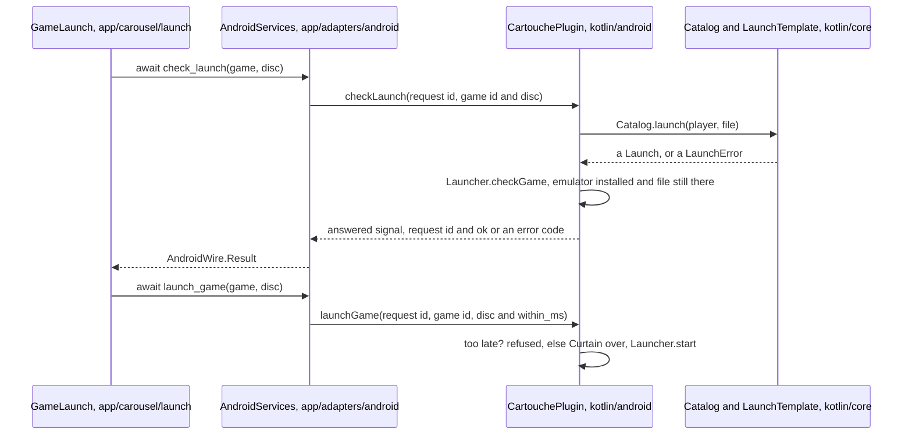

# Architecture

Three layers, each depending only on the one below it.

| Layer | Folder | Holds | Never holds |
|---|---|---|---|
| Godot shell | `app/` | scenes, input, display, animation, sound | a domain rule (what a game is, which file to launch) |
| Android plugin | `kotlin/android/` | Android APIs, files, threads, network, everything stored | a rule the core can state as a pure function |
| Core | `kotlin/core/` | the domain as pure functions over immutable values | Android, IO, `null` |

Consoles and media are folders of data and models (`app/carousel/consoles/`, `app/carousel/media/`); platforms
and emulators are JSON files in `app/data/`. The words are in [GLOSSARY.md](GLOSSARY.md).

## How a press travels

GDScript reaches the plugin through one file, the `AndroidServices` autoload. Getters (`battery`, `browse`,
`title_marks`) answer at once. Every operation is a coroutine: the plugin works off Godot's thread and answers once
through its `answered` signal. The plugin's other signals (`art_changed`, `art_progress`,
`label_variant_downloaded`, `battery_changed`) become `AndroidServices` signals of the same names.

On a desktop or in the editor there is no plugin: `AndroidServices` calls `DesktopPlugin`, which has the plugin's
method names and answers in the same JSON from `app/dev/demo/desktop.json`. The screens cannot tell the difference.

## Where state lives

Each state is one value with one owner. Read it there; never keep a copy or a flag beside it.

| State | Owner | Notes |
|---|---|---|
| The library and its revision | `Held` in `LibraryService.kt`: `Unread`, `Read` or `Unreadable` | Read from its file on first use; every write adds one to `revision`, sent with each library answer |
| Which library is shown | `Shown` in `LibraryService.kt`: `Users` or `Demo` | `Demo` is the made-up library of `--demo-games`; its art is never looked for |
| A scraping run | `Scraping` (core), changed only by its operations | Each request taken is an `UnderWay`, with what it waits again as if it stops |
| Settings, selection, new games, what art remembers | one `StateFile` each | Read once, written only when changed |
| What may cross to Godot | `Wired`: the types of `Sent.kt`, and `Failed` | Only a `Wired` can be an answer's payload (INV-23) |
| The carousel's screen and who holds the presses | `Carousel.Screen` and `Carousel.Holder` in `carousel.gd` | `CarouselState`, pure, answers from them: `takes` (what the carousel takes now), `front`, `follows` (which screen may follow), `command` (what a press means, its rules tried in order) |
| What is under way on the carousel | the part that owns it (a launch, a toss, the ribbon, a glide) | Read once a frame into the flags of `CarouselState.busy` |
| The page in front | `ScreenFlow` | Opens a page only through `_present`, which awaits `Page.present(request)` |
| Whether a page takes presses | `Page.phase` (`AWAY`, `ENTERING`, `LIVE`, `BUSY`, `LEAVING`) | `Page.busy_while(work)` holds the presses for the time of `work`, or returns early once something lets the page go (B two seconds into a settings save), the work going on; `holds_presses()` is what tests read |
| The ordering ring | `ConsoleOrder.Flow`: `CLOSED`, `OPENING`, `CHOOSING`, `SAVING`, `CLOSING`, `PLACING` | `ConsoleWheel` (pure) holds the order and the console held; `Placing` (pure) the placing of a console just added |
| Each console of the row | `ConsoleRow.Item`, with its place on the ring in `ConsoleRow.OnRing` | `ConsoleRow.Stand` is where a console's silhouette stands on the ring |
| The search ribbon | `SearchModel`, a class with no node | A press changes it and answers what `GameSearch` then plays |
| How the selected game stands | `SelectedStand`, told whole to `ShelfRow` | Posed, tossed, staged for its properties, or outside the row for a launch |
| The background shown | `Backdrop.palette` | See [Studio](#studio) |

## The core

`kotlin/core/src/main/kotlin/app/cartouche/core/`, tests in the same package under `kotlin/core/src/test/`. Pure
Kotlin on Arrow, kotlinx.serialization and XZ for Java. The plugin is its only caller.

- Functions are total: a failure is a typed error (`Raise` or `Either`), absence an `Option`. Outside input (a
  definition file, a file name, a game file's bytes) becomes a value or a typed error, never an exception (INV-03).
- `Values.kt` holds the shared newtypes (`PackageName`, `ContentUri`, `FilePath`, `FileName`); its `intOrNone()`
  and `longOrNone()` are the one way to parse a number.
- IO goes through ports the plugin implements: `ByteSource` for a file's bytes, a `children` function for a
  folder's listing. Tests implement them in memory.

| Package | Files | What it decides |
|---|---|---|
| `platforms` | `Catalog.kt`, `MediaRule.kt`, `ArtKind.kt`, `SerialScans.kt`, `CurtainTimes.kt` | Parses the definition files and profiles; which players open a file and how one opens a game (`Catalog.launch`); a game's medium from its region; what a platform's scans show; the curtain's time per emulator |
| `launch` | `LaunchTemplate.kt`, `LaunchSpec.kt`, `GameFile.kt`, `StartDeadline.kt` | Parses a launch template (`am start` arguments; the file documents the grammar) and resolves it for a game file. A template can grant only read access to that one file (INV-01, INV-02). A start asked too long ago is refused (INV-21) |
| `library` | `FolderWalk.kt`, `Scan.kt`, `GameName.kt`, `TitleIndex.kt`, `Game.kt`, `Library.kt`, `ConsoleVariant.kt`, `Arrivals.kt`, `LibraryFormat.kt`, `DemoLibrary.kt` | Walks a folder within limits (INV-09); sorts its files into games and ignored files, each once (INV-08); identifies a file from its facts first, then its name, or not at all (INV-10); merges a rescan without losing choices (INV-12); removes a platform whole (INV-13); the games a re-read brought (INV-25); the stored format (INV-11) |
| `files` | `FileFacts.kt`, `ByteSource.kt`, `FileReading.kt`, `Iso9660.kt`, `ChdImage.kt`, `Cartridges.kt` | What a file's bytes say: a disc's serial (ISO or CHD, read on demand and bounded), a cartridge's CRC32 as No-Intro counts it, or nothing |
| `shelves`, `search` | `Shelves.kt`, `Finder.kt`, `Words.kt`, `Query.kt`, `TitleLetter.kt` | One shelf per platform in title order, the `Selection` restored on it; the ribbon's index (by letter or region) and search |
| `art`, `regions` | `ArtSources.kt`, `ArtIndex.kt`, `TextureTable.kt`, `Regions.kt`, `PreferredRegion.kt`, `Artwork.kt`, `LabelCut.kt`, `LabelFraming.kt`, `Scraping.kt`, `Absences.kt`, `ProvisionalArt.kt`, `ScreenScraper.kt` | Which images a game may get and in which order (`ArtSources.order`), closest region first; how a label is cut from a scan; a run's state; what no source has; ScreenScraper's availability and limits |
| `settings`, `storage` | `Settings.kt`, `Setting.kt`, `VersionedJson.kt`, `DocumentPaths.kt` | The app's choices and their declarations; the versioned JSON of a small stored state; a document id as a path |

## The plugin

`kotlin/android/src/main/kotlin/app/cartouche/android/`. A Godot Android plugin (v2); its manifest lists each
permission with its reason.

| File | Responsibility |
|---|---|
| `CartouchePlugin.kt` | The only class Godot sees (the `CartoucheAndroid` singleton); its `@UsedByGodot` methods are the whole API. `onLibrary(requestId) { }` runs a call on the library thread and answers it, and `timed` (`Wire.kt`) traces how long a step took: a new method uses them, never its own threading |
| `Threads.kt` | The coroutine scope and dispatchers: one library thread running library work in arrival order, a planning thread, a low-priority thread for the search finders, the variant downloads |
| `Reference.kt` | What `loadCatalog` loads, as one immutable value. A platform's tables (titles, prints, art) are read from the APK's assets on first need, off Godot's thread; the art tables are let go once a label run is over |
| `Sent.kt`, `Wire.kt` | [The wire](#the-wire) |
| `LibraryService.kt` (package `library`) | Scans, counts, choices, removals, selections and launch lookups, one at a time. A scan reads the facts of new or changed files only (`FactsStore`). A re-read (`refreshPlatform`, as the app comes to the screen) writes the library only when it changed and marks the games it brought (`Arrivals`) |
| Package `storage` | `AtomicText.kt`: every write is whole or not at all. `Folders.kt`: read access to picked folders, nothing more. `LibraryStore.kt`, `StateFile.kt`, `FactsStore.kt`, `DocumentBytes.kt` |
| Package `launch` | `Launcher.kt`: `checkGame` starts nothing (INV-05), `start` starts the activity. `IntentMapper.kt`: the intent from a `LaunchSpec`. `LateStart.kt`: refuses a start past its deadline. `Curtain.kt`: the black window while the emulator starts (INV-07) |
| Package `art` | `ArtService.kt` coordinates; `Scraper.kt` runs a run on a few workers and tells Godot; `Fetch.kt`, `ArtFetching.kt` and `ScreenScraperFetch.kt` download within the sources' limits, credentials never stored or traced (INV-19); `ArtImages.kt` cuts; `ArtStore.kt` stores whole images only (INV-18); `VariantDownloads.kt`, `LabelChoices.kt`, `OwnPictures.kt` serve the label chooser |
| `PendingPick.kt`, `Battery.kt`, `NativeHeap.kt`, `DebugOptions.kt` | A system picker answered exactly once (INV-06); the battery; freed memory handed back to the system (`releaseMemory`); the debug arguments |

### The wire

Every getter, answer and signal crosses the JNI bridge as one JSON text of a type of `Sent.kt` (INV-23). An
answer is `{"request_id", "ok", …its fields}`, a failure `{"request_id", "ok": false, "code", "detail"}`; a library
call adds the library's `"revision"`. Keys are the properties' names in snake case, an enum crosses as its
`@SerialName`, an `Option` is an absent key until it has a value.

`app/adapters/android/android_wire.gd` (`AndroidWire`) is generated from those types by `WireScriptTest`, failure
codes included; only what follows a class's `# By hand` line is edited. To change what is sent, change `Sent.kt`,
then run `cd kotlin && ./gradlew :android:testDebugUnitTest --tests '*WireScriptTest' -Pwire.write=true`.
`DesktopDemoTest` fails when `desktop.json` is out of date and writes the new one.

## The Godot shell

The main scene is `app/carousel/carousel.tscn`. Three autoloads start before it: `Diagnostics`
(`app/dev/diagnostics.gd`), `Android` (`app/adapters/android/android_services.gd`) and `Sounds`
(`app/audio/sound_effects.gd`).

| Folder | What it holds |
|---|---|
| `app/adapters/` | `AndroidServices`, the only caller of the plugin; `AndroidWire` (generated); `DesktopPlugin`; `AndroidButtons` (A confirms and B goes back, as Android names the buttons) |
| `app/screens/` | `ScreenFlow` and its pages: `Welcome`, the choice pages (`ChoiceScreen`, `CardChoiceScreen`), `CurtainPermission`, `NoConsole`, `AddConsole` (the one form adding and editing a console, with `form_choices.gd` and `form_motion.gd`), `SettingsMenu`, `ConfirmRemoval`. `Controls` draws buttons in the chosen style |
| `app/carousel/` | `Carousel`: the consoles screen, the games screen, the moves between them, input (`HeldDirection`, `Finger`, `StickTurn`, `carousel_touch.gd`). `ShelfRow`: the games row, a fixed pool of `ShelfPlace`s, so its cost does not grow with the library. `GameToss`, `GameArt` (labels read on a worker thread, one texture sent to the GPU per frame), `Appearance` (models loaded only when a library needs them), `Resting` |
| `app/carousel/consoles/` | One folder per console model, and the code they share: `ConsoleManifest`, `ConsoleModel` (the contract, as data), `ConsoleRow`, `LaunchAnimation`, `ConsoleSequence` (into and out of the games), `ConsoleLayer` (the consoles behind the games), the ring (`ConsoleOrder`, `ConsoleWheel`, `ConsolePlacing`, `RingMarks`) |
| `app/carousel/media/`, `app/carousel/models/` | One folder per medium; `ModelShape`, `ShapedMesh`, `MeshBuilder` and the shared shaders. Models share `solid.gdshader`, `label.gdshader` and a few others, never standard materials: every distinct material is a shader the driver keeps |
| `app/carousel/launch/` | `GameLaunch`: a launch from A to the carousel shown again (INV-21). `Insertion`: the motion of a medium into a console without its own animation |
| `app/carousel/search/` | `GameSearch` (the ribbon), `SearchModel`, `title_marks.gd` |
| `app/carousel/new_games/` | `NewGames` re-reads every console's folder as the app comes to the screen and shows a changed library once the carousel is free; `RailBadge` and `NewGameDots` mark the new games |
| `app/carousel/properties/` | `DiscProperties`: a game's label (the images on offer, a picture of the user's own and its framing) and name |
| `app/studio/` | The shared look: [Studio](#studio) |
| `app/dev/` | `Diagnostics`, `CarouselBench`, `FrameShots`, `StartTrace`, `DevSounds`, and the [debug bridge](debug-bridge.md), left out of release exports by `app/addons/cartouche_dev/` |
| `app/addons/cartouche_android/` | Adds the plugin's AARs to Android exports; versions are declared once, in `kotlin/gradle/libs.versions.toml` |

An exported app finds every `ShapedMesh` already built: the export plugin
`app/addons/cartouche_dev/shaped_mesh_export.gd` stores the arrays the code builds. `ModelFade` fades a model with
the `*_fading.gdshader` copies of its shaders, as the mobile renderer ignores per-instance transparency.

### Resting

`Resting` (`app/carousel/resting.gd`) lets the app rest. After a few seconds without a press, Godot's low
processor mode draws only what changes; later, whatever moves by itself (the nodes of the group `paced`) slows to
a stop. The first press wakes everything and acts as usual (INV-20). Once still, and as the app leaves the screen,
`Resting` has the plugin hand freed memory back to the system (`Android.release_memory`).

The engine's Android frame pacer stays on, as Godot has it by default. Off, the
games row gliding for 30 s missed five times more frames on the reference handheld. Its cost: as the app wakes from
a rest, the processor still at its resting clock, a late first frame can hold half the screen's rate for a few
seconds; a game's properties therefore keep the app awake, their way back being a motion.

- A frame is drawn when anything wrote to the renderer since the last one, even a value equal to the one it had.
  Code that runs at every frame writes only what changed. `at_rest_test.gd` names the nodes still writing.
- Anything new that moves on its own joins the `paced` group, or keeps the app awake while it plays
  (`Resting.moving`).
- The one exception is the background's pixel veil, on by default: while it moves, the shown `Cyclorama` is drawn
  again. With the veil off, rest draws nothing.
- A frame drawn again redraws only what changed below it: each `MediaView` keeps its medium in a picture of its
  own, and the carousel's 3D is not drawn while nothing in it shows (`Carousel.shows_3d`).

## Studio

`app/studio/` is the look every screen shares: a small lit photo studio, pieces in two materials (opaque satin,
translucent frost), text in Plus Jakarta Sans and IBM Plex Mono. Use the piece listed here, never a new one.

| Need | Use |
|---|---|
| A colour, size, font role or timing | `StudioTokens` (`studio_tokens.gd`): generated from the design's tokens, never edited by hand (`tokens_test.gd` fails on a hand edit). Ask in an issue for a value to change. Never type a colour of the look in a script |
| A console's colour (its gel) | `StudioTokens.GEL`, read by `ConsoleManifest.gel_of(folder)`; painted through `Palette.gel` |
| A material behind a container | `SatinPanel`, its `look` a `StudioMaterial.Look` (`SATIN`, `FROST`, `KEY`, `PLUS`, `FOCUS`) |
| A material behind pieces a control draws itself | `SatinPanel.Backing` |
| A material on Godot's own buttons, fields, cards | `SatinStyle.apply_to` |
| The backdrop | `Cyclorama`: the background's wall, and the pixel veil over it |
| Button hints | `ButtonHint` children of the one `HintRow` |
| Text at the design's exact width | `StudioText.of(role, text)`, then `fit(room)` and `draw(canvas, at, color)`; `StudioLabel` and `StudioPill` for a theme label and a line on a frost pill |
| A console's logo | `LogoView.show_logo(LogoView.Slot.RAIL_TILE, folder)` |
| A console's still picture | `Plinth.show_console(folder)` loads `plinth.png` of the console's folder (`plinth_2x.png` in a larger window), drawn ahead by `scripts/bake_plinths.sh`: the forms never draw a model |
| Lights for a model and screen | `StudioLights.rig_of(model, screen)`, from `app/data/studio_lights.json` |
| Motion | `Motion` (`motion.gd`): `Motion.Spring`, `Motion.curve(Motion.Easing.EASE)` as a tween's interpolator, `Motion.restart(node, old)` for a motion replacing the one before, `Motion.Timeline` for a reversible transition sampled with `Motion.phase` |
| A place on a screen of any shape | `ScreenLayout`, `StageLens`, `Rests` ([adding-a-screen.md](adding-a-screen.md#screens-of-every-shape)) |

**Backgrounds.** Each background is a scheme of the tokens (`StudioTokens.SCHEMES`), read into typed fields by
`Palette`. `Backdrop` holds the one palette shown; `Backdrop.show(choice, veil)` changes the project theme's items
and emits the theme's change once. That is how a drawing follows the background:

- a control that reads `Backdrop.palette` in `_draw` needs nothing more;
- a control that keeps something made from the palette (a `StudioMaterial`, a shader parameter, a texture) makes it
  again in `_notification(NOTIFICATION_THEME_CHANGED)`;
- a rectangle in a palette colour is a `PaletteRect`;
- a preview of another background draws with its own `Palette` (`Cyclorama.palette`, a `SatinPanel.Backing` made
  with it).

**Data tuned by eye.** `app/data/turntable.json` (each console's start pose on the plinth),
`app/data/studio_lights.json` (the lights per model and screen) and `app/data/media_poses.json` (each medium's
pose on the games screen). The first two are written by a tuning tool through the debug bridge, never by hand. A
missing entry gives a default.

**The games screen.** `GamesLayout` (`app/studio/games/games_layout.gd`) gives the row's poses, `TitlePlace`
where the title goes, `GameTitlePill` draws it; each place draws its game through one `MediaView`. The other
folders: `app/studio/rail/` (`ConsoleRail`, `RailTile`), `app/studio/ring/` (`RingFit`, `Placing`),
`app/studio/chooser/` (`StudioChooser`), `app/studio/transitions/` (`FormEntry`, `ConsoleArrival`),
`app/studio/views/` (`MediaView`, `Plinth`, `StudioLights`).
